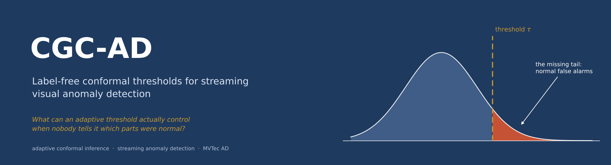
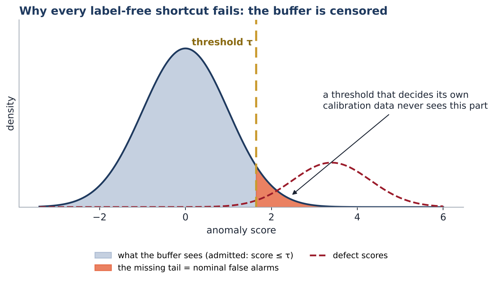
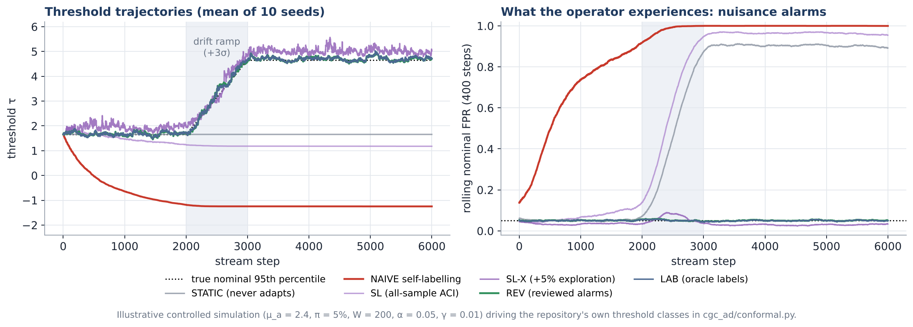
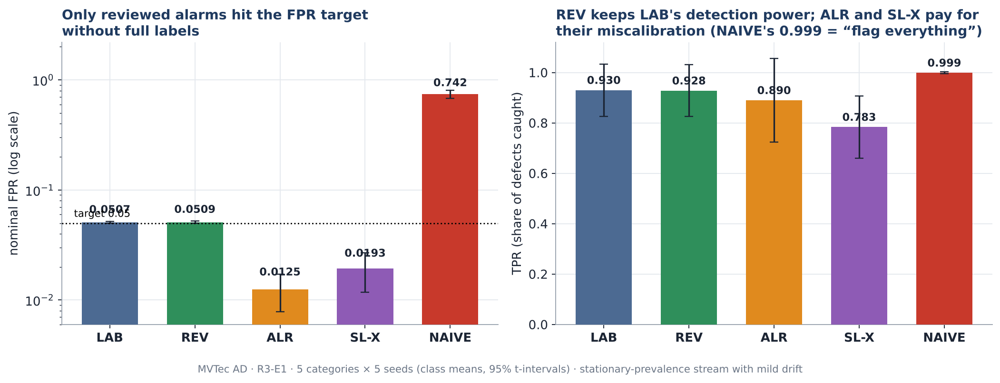
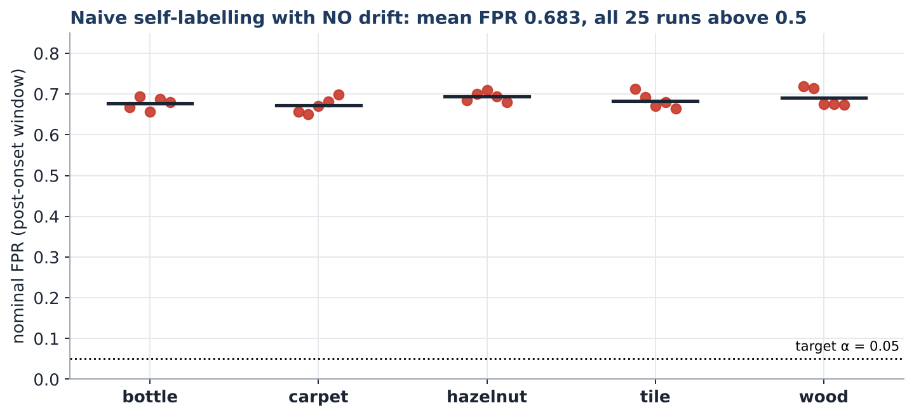
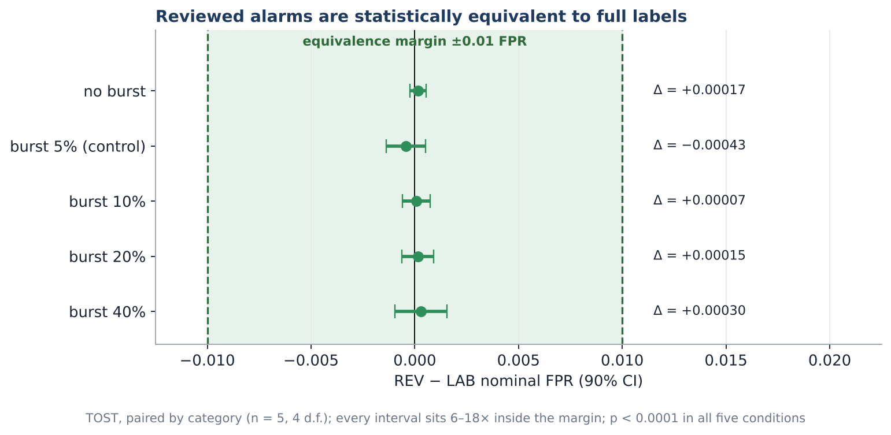
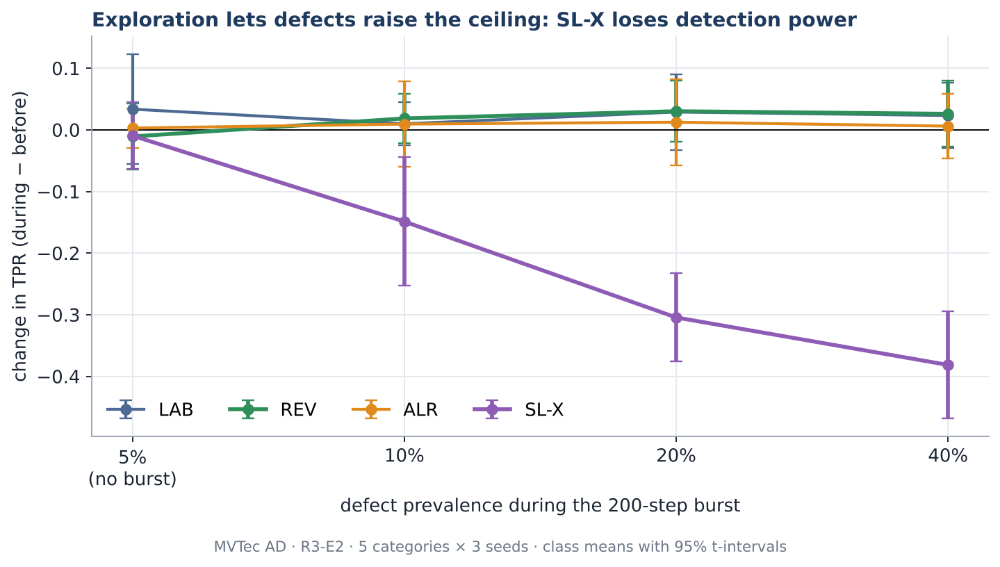
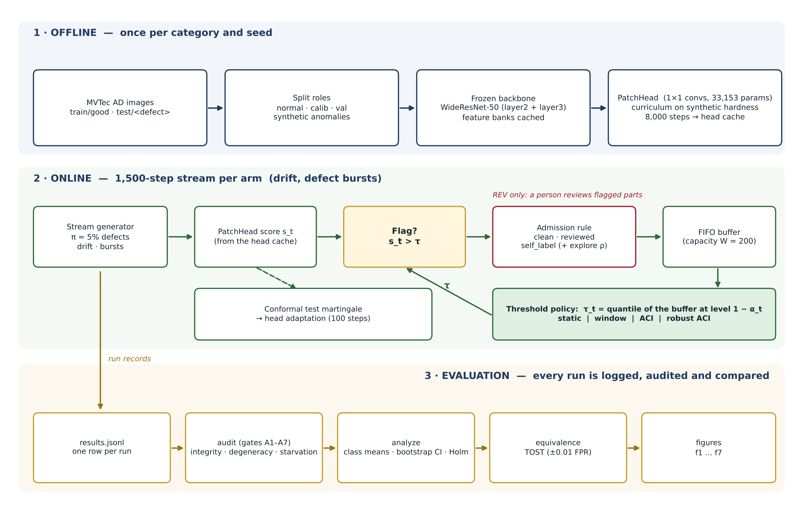

<p align="center">
  
</p>

<p align="center">
  <a href="#quick-start"></a>
  <a href="#data"></a>
  <a href="#reproduce-the-paper-numbers"></a>
  <a href="#citation"></a>
</p>

<h1 align="center">CGC-AD</h1>
<p align="center"><b>What can an adaptive conformal threshold actually control when nobody tells it which parts were normal?</b></p>

A camera on a production line is calibrated once. Lamps age, sensors get swapped, product variants appear, and the threshold quietly drifts off its false-alarm target. **Adaptive conformal inference (ACI)** can hold that target, *but only if it is told which inputs were nominal* — and real lines do not label their streams.

This repository is the research code base behind the manuscript **“False Alarms Are the Missing Tail: What a Label-Free Conformal Threshold Can Control.”** It contains a small, fully reproducible streaming simulator for visual anomaly detection on MVTec AD, every threshold variant that the paper compares, the audit and statistics tooling used to keep the experiments honest, and the raw result files.

> **TL;DR** — None of the three obvious label-free substitutes controls the nominal false-positive rate. Feeding ACI the **review results of flagged parts only** does: it matches fully labelled ACI to within 0.01 FPR in every condition tested, while labelling about **10 %** of the parts.

---

## Contents

- [The problem in one picture](#the-problem-in-one-picture)
- [Key results](#key-results)
- [How it works](#how-it-works) · [The seven arms](#the-seven-arms) · [What each arm controls](#what-each-arm-controls)
- [Repository layout](#repository-layout)
- [Quick start](#quick-start) · [Data](#data) · [Running experiments](#running-experiments)
- [Reproduce the paper numbers](#reproduce-the-paper-numbers)
- [Configuration](#configuration) · [Backbones](#backbones)
- [Metrics and result files](#metrics-and-result-files)
- [Audits: checking the experiment, not just the code](#audits-checking-the-experiment-not-just-the-code)
- [Testing](#testing)
- [Engineering notes](#engineering-notes)
- [Known issues in this snapshot](#known-issues-in-this-snapshot)
- [Citation](#citation) · [Acknowledgements](#acknowledgements) · [License](#license)

---

## The problem in one picture

<p align="center">
  
</p>

A conformal threshold is a quantile of a *calibration buffer* of normal scores. If the threshold also decides what enters that buffer (“a part is normal if it was not flagged”), the buffer is **censored**: it never contains the normal parts that scored above the threshold — exactly the false alarms the threshold is supposed to control. Three things follow, all proved in the paper and all reproduced by this code:

| Shortcut a practitioner would try | What goes wrong |
|---|---|
| **Self-labelling** — treat unflagged parts as normal | The ACI error is identically zero, so the threshold can only move **down** (a *ratchet*), even with no drift. Under any score-thresholded admission the largest buffered score is also a *ceiling* that cannot rise and that erodes. |
| **Feed ACI every alarm** | ACI regulates the *alarm rate*, not the FPR: `FPR = (α − π·TPR) / (1 − π)`. When defects use up most of α, the FPR collapses far below target and detection power is lost. |
| **Explore** — admit some flagged parts at random | Lifts the ceiling, but during a **defect burst** it lifts it *with defects*, so the threshold rises over real defects and TPR falls. |

**The fix** uses work that inspection lines already do: every flagged part is routed to a person. Feeding those dispositions back re-admits the false alarms (the missing tail) and restores nominal control, with a closed-form bias: `FPR = α(1 − π·TPR) / (1 − π)` (≈ 1.004 × α at π = 5 %, TPR = 0.93).

The illustration below drives this repository's own threshold classes (`cgc_ad/conformal.py`) with a small numpy simulation — no GPU needed (`scripts/make_readme_assets.py`).

<p align="center">
  
</p>

---

## Key results

All numbers below are recomputed directly from the JSONL files in [`tests/results/`](tests/results) (R3 sweeps: **MVTec AD, 5 categories, frozen WideResNet-50 + 33,153-parameter patch head, α = 0.05, stream of 1,500 steps at 5 % defects**) and match the manuscript.

<p align="center">
  
</p>

| Arm | What it uses | Nominal FPR (target 0.05) | TPR | ΔTPR vs LAB |
|---|---|---:|---:|---:|
| **LAB** | oracle labels on every part | 0.0507 | 0.930 | — |
| **REV** | review results of *flagged* parts only | **0.0509** | 0.928 | −0.002 |
| ALR | every alarm (ideal clean buffer) | 0.0125 | 0.890 | −0.040 |
| SL-X | no labels, 5 % exploration | 0.0193 | 0.783 | −0.147 |
| NAIVE | no labels, self-labelling | 0.742 | 0.999 | +0.069 |

**Naive self-labelling collapses even with no drift at all** (mean FPR **0.683**, all 25 runs above 0.5, while AUROC still reads 0.985):

<p align="center">
  
</p>

**Reviewed alarms are statistically equivalent to full labels** (TOST, margin ±0.01 FPR fixed before the runs; *p* < 0.0001 in all five conditions; every interval sits 6–18× inside the margin):

<p align="center">
  
</p>

**Exploration costs detection power in defect bursts** — SL-X loses 0.149 / 0.304 / 0.382 TPR at 10 / 20 / 40 % burst prevalence (0.75 → 0.37 at the largest burst), while REV and LAB stay flat:

<p align="center">
  
</p>

Reviewed alarms need labels on only **9.9 %** of a stationary stream. The paper also gives a closed form for imperfect reviewers (rejecting a false alarm inflates FPR by `1/(1 − ε₀(1 − α))`; passing a defect is the dangerous error during bursts) and three cheap runtime diagnostics for failures that AUROC cannot see: a **falling admission rate**, an **alarm rate persistently above α**, and an **`n ≥ 1/α − 1` attainability audit** (MVTec `toothbrush` has only 15 calibration images and cannot express α = 0.05, so it is excluded).

---

## How it works

<p align="center">
  
</p>

1. **Offline (once per category and seed).** Normal images are split into roles (train / calibration / validation); synthetic anomalies (a CutPaste/NSA-style family controlled by one hardness scalar *h ∈ [0, 1]*) are generated; a **frozen** backbone extracts multi-stage features that are cached to disk; a tiny **PatchHead** (1×1 convolutions, 33,153 parameters) is trained on the synthetic anomalies with an optional curriculum over *h*. The trained head is cached so that **every arm of a comparison scores the stream with a bit-identical head**.
2. **Online (one stream per arm).** A stream generator mixes held-out normals and defects (prevalence π, optional drift, optional defect bursts). Each part gets a score `s_t`; it is flagged if `s_t > τ`; an **admission rule** decides which scores enter the FIFO buffer; a **threshold policy** (`static`, `window`, `aci`, `robust_aci`) turns the buffer into `τ`. An optional conformal test **martingale** can trigger short head adaptations.
3. **Evaluation.** Every run appends one row to `results.jsonl`; `audit`, `analyze`, `equivalence` and `figures` read those files.

### The seven arms

Arms differ **only** in the threshold/stream fields below (exact overrides recovered from the bundled result files):

| Arm (paper) | Result tag | `stream.buffer_protocol` | `threshold.aci_update_on` | `stream.admit_explore` | `threshold.policy` |
|---|---|---|---|---|---|
| **STATIC** | `r3_static` | – | – | – | `static` |
| **LAB** (labelled) | `r3_labelled` | `clean` | `admitted` | 0 | `aci` |
| **REV** (reviewed) | `r3_reviewed` | `reviewed` | `admitted` | 0 | `aci` |
| **ALR** (alarmrate) | `r3_alarmrate` | `clean` | `all` | 0 | `aci` |
| **SL-X** (patch) | `r3_patch` | `self_label` | `all` | 0.05 | `aci` |
| **SL** (p1only) | – *(R4 arm)* | `self_label` | `all` | 0 | `aci` |
| **NAIVE** | `r3_naive` | `self_label` | `admitted` | 0 | `aci` |

> ⚠️ **Gotcha:** the default of `threshold.aci_update_on` is `all`. A “labelled” baseline therefore **must** set `aci_update_on=admitted` together with `buffer_protocol=clean`; otherwise it silently regulates the alarm rate instead of the nominal FPR. The audit module checks for exactly this mislabelling.

### What each arm controls

| Arm | Quantity regulated | Closed form at a stationary operating point |
|---|---|---|
| LAB | nominal FPR | `f = α` |
| REV | nominal FPR (small known bias) | `f = α(1 − π·r)/(1 − π)` |
| ALR, SL, SL-X | **alarm rate** | `f = (α − π·r)/(1 − π)`, floored at 0 |
| NAIVE | nothing (ratchet) | threshold non-increasing; `FPR → 1` |

with `π` the defect share and `r` the TPR. `python -m cgc_ad.analyze --summary` prints this table for any result file, together with the residual of each identity.

### Drift, bursts and buffer protocols

- **Drift kinds** (`drift.kind`): `none`, `brightness`, `gamma`, `contrast`, `blur`, `noise`, `combo` — each ramps in from `drift.onset` over `drift.ramp` steps with strength `drift.severity`.
- **Defect bursts**: `stream.burst_start`, `burst_len`, `burst_prevalence` (the paper uses a 200-step burst from step 900 at 5 / 10 / 20 / 40 %).
- **Buffer protocols** (`stream.buffer_protocol`): `clean` (oracle), `self_label`, `gated`, `reviewed`; `stream.contamination` models labelling noise and `stream.admit_explore` the random admission of flagged parts.
- **Curriculum controllers** (`curriculum.kind`): `fixed`, `random`, `oracle`, `proportional` (the original CGC-AD controller), `pid`, `distributional`. They set the hardness of the synthetic anomalies the PatchHead trains on. An earlier curriculum study ended in a null result (see `configs/backbone_ablation.yaml`), and the paper configs use `random`, which the code documents as the decisive control for any curriculum claim.

---

## Repository layout

```text
.
├── README.md
├── LICENSE
├── pyproject.toml              pip install -e .   (package: cgc_ad)
├── requirements.txt
├── pytest.ini
├── .gitignore  .gitattributes
├── .github/workflows/tests.yml numpy-tier CI (no GPU needed)
├── assets/                     figures used in this README
├── scripts/
│   ├── make_readme_assets.py   regenerate every figure from tests/results
│   └── repair_jsonl.py         split result lines that contain two JSON objects
├── configs/
│   ├── quick.yaml              smoke test (2 classes, tiny budget, ~3 min on a T4)
│   ├── main.yaml               phase-3 main grid: 15 classes, adaptation on
│   ├── breakdown.yaml          contamination breakdown (sweeps stream.contamination only)
│   ├── backbone_ablation.yaml  backbone ablation for the curriculum study
│   └── paper1.yaml             14-category confirmatory suite for the manuscript (R4)
├── cgc_ad/
│   ├── config.py               dataclass configs, YAML loading, --set overrides, run hash
│   ├── data.py                 MVTec/VisA loader, split roles, drift transforms, stream
│   ├── synth.py                hardness-parameterised synthetic anomalies
│   ├── backbones.py            frozen-backbone registry + feature extraction
│   ├── model.py                PatchHead (1×1 convs)
│   ├── curriculum.py           hardness controllers
│   ├── conformal.py            static / window / ACI / robust-ACI thresholds, martingale
│   ├── engine.py               train_head, run_stream, stream metrics, traces
│   ├── checkpoint.py           atomic checkpoints + feature-bank disk cache
│   ├── tracking.py             per-run logging (TensorBoard / W&B optional)
│   ├── run.py                  command-line entry point
│   ├── analyze.py              operating points, contrasts, identities, trends
│   ├── audit.py                experiment-validity audits
│   ├── equivalence.py          TOST equivalence tests
│   └── figures.py              figures f1 … f7
└── tests/
    ├── test_*.py               unit / integration tests
    ├── conftest.py
    └── results/                raw JSONL results (R3 sweeps and earlier phases)
```


---

## Quick start

```bash
git clone https://github.com/Vishwanath-06/CGC-AD.git && cd CGC-AD
python -m venv .venv && source .venv/bin/activate     # Windows: .venv\Scripts\activate
pip install -r requirements.txt                       # see the note on PyTorch below
pip install -e .                                      # optional: makes `cgc_ad` importable anywhere
```

PyTorch and torchvision are not pinned in `requirements.txt` because the right wheel depends on your CUDA setup. The experiments in the paper ran on **PyTorch 2.10.0 + CUDA 12.8 on a Tesla T4 (Kaggle)**.

Everything under `cgc_ad/conformal.py`, the analysis/audit/equivalence tooling and the figure scripts is **numpy-only**, so you can explore the threshold theory and re-analyse the bundled results on a laptop with no GPU:

```bash
python scripts/make_readme_assets.py        # rebuilds assets/ (≈ 1 min)
python -m cgc_ad.analyze tests/results/e1_e3_results.jsonl --summary
```

### Data

Download **MVTec AD** and point `data.root` at it (default `/kaggle/input/mvtec-ad`):

```text
<root>/<category>/train/good/*.png
<root>/<category>/test/good/*.png
<root>/<category>/test/<defect>/*.png
```

`data.dataset: visa` loads VisA in the same layout. Per category and seed the loader builds the roles *train / calibration / validation* (`data.n_calib`, `data.n_val`) and synthetic-anomaly splits. Categories whose calibration set is too small for the chosen α are rejected by the attainability audit — e.g. `toothbrush` (15 calibration images, α = 0.05 needs ≥ 19).

### Running experiments

```bash
# smoke test: tiny budget, one class
python -m cgc_ad.run --config configs/quick.yaml

# a labelled / reviewed / naive arm on two classes, three seeds, resumable
python -m cgc_ad.run --config configs/paper1.yaml --tag demo_reviewed \
    --classes bottle,tile --seeds 0,1,2 --resume \
    --set stream.buffer_protocol=reviewed threshold.aci_update_on=admitted \
          stream.admit_explore=0.0
```

| Flag | Meaning |
|---|---|
| `--config` | YAML file (required) |
| `--set a.b=v …` | override any config field; the value is cast to the field's existing type (bool / int / float / list) |
| `--tag` | run label stored in every result row |
| `--classes`, `--seeds` | comma-separated overrides |
| `--stage gate\|train\|full` | `gate` = monotonicity check only · `train` = plus static evaluation · `full` = plus the deployment stream |
| `--resume` / `--fresh` | skip finished runs and continue interrupted ones / start over |
| `--time-budget-min` | stop launching new categories after this many minutes (for session wall-clock limits) |

Output layout under `out_dir`:

```text
results.jsonl                       one row per (run_hash, class, seed)
runs/<tag>/<hash>/<class>/s<seed>/
    config.json  log.txt  events.jsonl  metrics.csv
    monotonicity.json  result.json  trace.npz
    ckpt/train_latest.pt  ckpt/train_best.pt  ckpt/stream_latest.pt
```

Everything is append-only or atomically replaced, so a Kaggle session killed by the time limit resumes from its last checkpoint.

---

## Reproduce the paper numbers

The bundled R3 results contain every number in the tables above — no GPU required.

```bash
# 1. operating points, identities, ceiling and confound checks for all arms
python -m cgc_ad.analyze tests/results/e1_e3_results.jsonl --summary

# 2. REV vs LAB equivalence (TOST, margin ±0.01 FPR)
python -m cgc_ad.equivalence tests/results/e1_e3_results.jsonl \
    --contrast r3_reviewed r3_labelled --metric fpr_post --margin 0.01
#   mean difference +0.00017 · 90% CI [-0.00022, +0.00056] · TOST p = 3.54e-07 · EQUIVALENT

# 3. paired contrasts with bootstrap intervals and Holm correction
python -m cgc_ad.analyze tests/results/e1_e3_results.jsonl \
    --contrast r3_reviewed r3_labelled --metrics fpr_post tpr_post

# 4. defect bursts (R3-E2) — first repair the one malformed line, see Known issues
python scripts/repair_jsonl.py tests/results/e2_e4_results.jsonl
python -m cgc_ad.analyze tests/results/e2_e4_results.jsonl --summary

# 5. all README figures
python scripts/make_readme_assets.py
```

| Result file | Contents |
|---|---|
| `e1_e3_results.jsonl` | R3-E1 (six arms, brightness drift) and R3-E3 (`r3_naive_nodrift`) — 5 categories × 5 seeds |
| `e2_e4_results.jsonl` | R3-E2 (defect bursts at 5/10/20/40 %, four arms) and R3-E4 (`r3_ceiling_s*`: drift-strength sweep) |
| `e1.jsonl`, `e3.jsonl` | subsets of `e1_e3_results.jsonl` |
| `phase1_results.jsonl` | monotonicity-gate sweep over synthetic-anomaly strength |
| `phase2_results.jsonl` | `random` vs `decoupled` curriculum controls |
| `phase3_results.jsonl` | window-size sweep of the threshold buffer |
| `phase4_results.jsonl` | ratchet / contamination sweeps |
| `phase5_results.jsonl`, `phase6_results.jsonl` | distributional controller; controller-signal ablation |
| `phase_e1_6_results.jsonl` | an earlier round-3 E1 run (before the `reviewed` arm was added) |

The R3 runs used `brightness @ 0.25` drift with head adaptation enabled — the manuscript discusses both protocol deviations, and the audit flags them (see [Audits](#audits-checking-the-experiment-not-just-the-code)). `configs/paper1.yaml` is the corrected 14-category design (no adaptation, `combo @ 0.3` drift, cached heads) whose runs are in progress.

---

## Configuration

Configs are plain YAML mapped onto dataclasses in `cgc_ad/config.py`; every field is overridable with `--set section.field=value`. A stable hash of the config is used as the run id, which is what makes `--resume` safe.

| Section | Main fields |
|---|---|
| `data` | `dataset` (`mvtec`\|`visa`), `root`, `classes`, `image_size`, `n_calib`, `n_val` |
| `synth` | `n_levels`, `variants_per_image`, hardness range |
| `model` | `backbone`, `stages` / `layers`, `feat_size`, `proj_dim`, `head_width`, `topk_frac` |
| `train` | `max_steps` (matched-budget control), `batch_size`, `lr`, `amp`, `deterministic` |
| `curriculum` | `kind`, `h0`, controller gains, `signal` (`conformal`\|`raw`\|`synth_percentile`\|`zscore`) |
| `threshold` | `policy`, `alpha`, `window` (buffer size W), `gamma_aci`, `trim_eps`, `aci_update_on` |
| `stream` | `steps`, `prevalence`, `buffer_protocol`, `admit_explore`, `contamination`, bursts, `adapt*` |
| `drift` | `kind`, `severity`, `onset`, `ramp` |
| `ckpt` | `dir`, `banks_dir`, `resume`, `head_cache` |

## Backbones

`model.backbone` selects a frozen backbone (the dataclass default is `resnet18`; every paper config uses `wide_resnet50_2`). Stage keys `s1 … s4` make configs architecture-independent (`[s2, s3]` reproduces the classic layer2 + layer3 setup). Print the registry with the built-in probe:

```bash
python -m cgc_ad.backbones --probe        # needs PyTorch and the pretrained weights
```

---

## Metrics and result files

Each row of `results.jsonl` contains the full `config`, an `env` capture (GPU, CUDA, torch version), training diagnostics (`steps`, `trainable_params`, clean AUROC, monotonicity) and a `stream` block with the metrics used in the paper:

| Metric | Meaning |
|---|---|
| `fpr_post`, `tpr_post` | FPR on normal parts / TPR on defects from drift onset to the end of the stream (steps 500–1,500 in the paper) — **primary endpoint is `fpr_post`** |
| `alarm_rate_post` | share of *all* parts flagged (compare with α) |
| `admission_rate_post` | share of parts that enter the buffer — a falling value reveals censoring |
| `mad_fpr` | mean absolute deviation of the windowed FPR from α after drift onset |
| `recovery_delay` | normal samples after onset until the windowed FPR re-enters the band [0.5α, 1.5α] |
| `tpr_burst`, `tpr_pre_burst` | detection rate inside / before a defect burst |
| `n_adaptations` | head adaptation events (should be 0 for threshold-only studies) |

---

## Audits: checking the experiment, not just the code

Unit tests show the code is right; **audits show the experiment is valid**. Each audit corresponds to a defect that actually occurred in an earlier results file produced by code that passed its tests.

```bash
python -m cgc_ad.audit tests/results/e1_e3_results.jsonl \
    --declared r3_naive r3_naive_nodrift          # naive arms are deliberate ablations
python -m cgc_ad.audit results/*.jsonl --strict   # exit 1 on any FAIL
```

| Audit | Catches |
|---|---|
| feedback semantics | an arm tagged *labelled/oracle* that actually regulates the alarm rate |
| A8 confounds | head adaptation mid-stream; drift too weak to move the scorer; “static” baselines that adapt |
| A1 sweep integrity | a sweep that varied the wrong field |
| A2 completeness | missing cells in the design |
| A3 budget matching | arms unmatched on gradient steps, synthetic budget or adaptation events |
| A4 gates | weak scorer (clean AUROC), attainability of α (`n ≥ 1/α − 1`) |
| A5 degeneracy | buffer starvation, FPR ≈ 1 (declared ablations are excluded) |
| A6 statistics | tiny *n*, multiple-comparison surface, duplicate runs |
| A7 provenance | duplicate hashes, mixed environments, silent failures |

**What to expect on the bundled R3 data** (and why it is not a bug): the budget audit fails because `naive` never adapts, and the confound audit flags that the R3 runs enabled head adaptation (so `r3_static` was recalibrated ≈ 1.24× per run) and that `brightness @ 0.25` barely moves the scorer (AUROC retention −0.0005). These are the *protocol deviations* reported in the manuscript and the reason `configs/paper1.yaml` was written.

---

## Testing

```bash
pip install pytest
python -m pytest tests -q
```

| Tier | Files | Needs |
|---|---|---|
| numpy only | `test_conformal`, `test_thresholds`, `test_identifiability`, `test_curriculum`, `test_audit` | nothing but numpy |
| torch | `test_backbones`, `test_pipeline`, `test_r4_fixes`, `test_integration` | PyTorch (+ weights / GPU for the heaviest ones) |
| simulation | `test_simulate` | `cgc_ad/simulate.py` |

The numpy tier covers the conformal quantile guarantee, all threshold policies, the algebraic identities from the paper (alarm-rate identity, reviewed-alarm bias), the curriculum controllers and the audit rules. See the next section for the state of this snapshot.

---

## Engineering notes

- **Reproducibility.** `train.deterministic: true` disables cuDNN autotuning. The whole stream is materialised from its own dedicated RNG (seeded from the run seed), so a resumed run replays the identical stream regardless of how far the training RNG advanced.
- **Resumable on Kaggle.** Training state (head, optimiser, AMP scaler, controller, step counter, all RNG streams) and stream state (head, threshold policy, martingale, buffer, partial records) are checkpointed; every write is *write-to-tmp → fsync → rename*.
- **Feature banks are the only expensive GPU work.** They are cached by a hash over every config field that can change the features and rebuilt only when that hash changes. `ckpt.banks_dir` defaults to `/kaggle/temp` (large, wiped between sessions).
- **Matched budgets.** `train.max_steps` gives every arm the same number of gradient steps; the audit enforces matched synthetic budgets and trainable-parameter counts.
- **Head cache.** With `ckpt.head_cache: true` every arm of a comparison scores the stream with a bit-identical head trained once per (category, seed).
- **Tracking.** Each run writes `config.json`, `log.txt`, `events.jsonl`, `metrics.csv`; TensorBoard and Weights & Biases are optional and degrade to no-ops.

---

## Known issues in this snapshot

Found while preparing this README (the first two are one-line fixes):

1. **`cgc_ad/audit.py`, `audit_feedback_semantics`** calls `get(...)` (lines ≈ 427–428) but the helper is named `_get`, so `python -m cgc_ad.audit` with the default `--audit all` raises `NameError`. Replace both `get(` with `_get(`; individual audits (`--audit sweep`, …) work as is.
2. **`curriculum.min_prob` is documented but not implemented.** `DistributionalController` never applies the probability floor, so `tests/test_curriculum.py::test_distributional_collapses_without_the_probability_floor` fails (the other 67 numpy-tier tests pass).
3. **`cgc_ad/simulate.py` is missing** from the snapshot this repository was created from, so `tests/test_simulate.py` cannot be collected. The manuscript's controlled simulation relies on it; `scripts/make_readme_assets.py` contains a small stand-alone version for the figure above.
4. **Malformed result lines.** Five lines in `e2_e4_results.jsonl` (1), `phase4_results.jsonl` (3) and `phase6_results.jsonl` (1) contain two JSON objects (a missing newline after an interrupted append); `analyze.load` uses `json.loads` per line and stops on them. Run `python scripts/repair_jsonl.py <file>` to split them.
5. `configs/paper1.yaml` refers to an `R4_PLAN.md` that is not part of the archive.
6. The torch-dependent tests (`test_backbones`, `test_pipeline`, `test_r4_fixes`, `test_integration`) need a PyTorch environment and were not run while preparing this README.

---

## Citation

If you use this code or the findings, please cite the manuscript:

```bibtex
@unpublished{tangella2026falsealarms,
  title  = {False Alarms Are the Missing Tail: What a Label-Free Conformal Threshold Can Control},
  author = {Tangella, Vishwanath and Padmanabha Reddy, Y C A and Pampati, SaiTeja and Pulabaigari, Viswanath},
  note   = {Manuscript, CICT 2026, Track 1},
  year   = {2026}
}
```

## Acknowledgements

- **Adaptive conformal inference** — I. Gibbs and E. Candès, *Adaptive conformal inference under distribution shift*, NeurIPS 2021, and *Conformal inference for online prediction with arbitrary distribution shifts*, JMLR 2024.
- **MVTec AD** — P. Bergmann, M. Fauser, D. Sattlegger, C. Steger, CVPR 2019.
- **Synthetic anomalies** — CutPaste (Li et al., CVPR 2021); **frozen features** — WideResNet (Zagoruyko & Komodakis, BMVC 2016).
- Developed in collaboration with IIIT Sri City.

## License

Released under the [MIT License](LICENSE).
